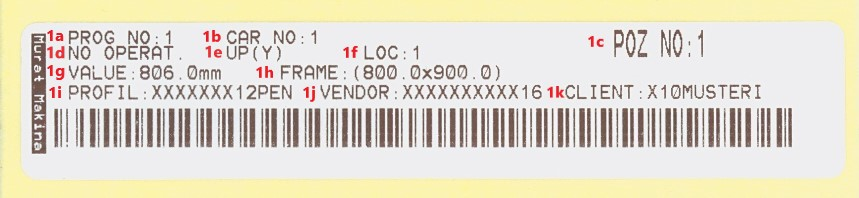

# MWM Welding Machines — Barcode Information

<div class="document-tools" markdown="1">
**[Download PDF](downloads/mwm-barcode-en.pdf)**
</div>

A label from a TT cutting machine or a cutting centre with the MSC_V2X interface can carry **profile selection and frame dimensions** to the welding machine. MWM_V3 reads the barcode using the field definition saved on the machine and loads the welding parameters from the machine's profile recipe.

This guide covers **welding machines using MWM_V3**. Field positions are not universal: the settings below apply to the supplied **31-character TT example**. An MSC label with the same data layout can use the same definition; a different layout requires its own definition. Compatibility with earlier MWM versions must be checked separately.

## 1. Reading the label



The readable text printed on a label and the **text encoded in the barcode** are different. MWM processes the text sent by the scanner. The image above illustrates the label layout; its dimensions differ from the 2894 × 1994 mm example below.

| Mark | Label information | Meaning for MWM |
|---|---|---|
| 1a | Prog No — program number | Label tracking; this field does not select the welding program in the direct-reading example below. |
| 1b | Car No — trolley number | Trolley tracking. Also present in the sample barcode. |
| 1c | POZ No — position number | Position tracking; the 31-character example has no separate position field. |
| 1d | Operation information | Cutting / machining operation description; does not directly select a welding recipe. |
| 1e | Assembly position — top, right, bottom, left | Position of the part in the frame; not a separate field in this barcode example. |
| 1f | LOC — location number | Box / compartment number on the trolley. Also present in the sample barcode. |
| 1g | Value / Part length | Length of one cut part. Do not confuse it with the frame dimensions used for welding. |
| 1h | Frame | Printed frame dimensions. MWM obtains its dimensions from the barcode's X/Y fields. |
| 1i | Profile code | Used with the gasket and colour code to find the machine's profile recipe. |
| 1j | Vendor / Dealer | Order tracking; not used in this direct-reading example. |
| 1k | Client / Customer / Order | Order tracking; not used in this direct-reading example. |

For the relationship between the printed text and the TT batch-file columns, see the [TT barcode label reference](https://hm-info.github.io/tt-barcode/Turkish). This guide explains how the welding machine uses the incoming data.

## 2. Fields in the sample barcode

**Text received from the scanner — 31 characters:**

```text
K1001PROFILE CODE01289400199400
```

**Separated for explanation:** the vertical bars are not part of the barcode. The space in `PROFILE CODE` is a real character.

```text
K | 1 | 001 | PROFILE CODE | 0 | 1 | 28940 | 0 | 19940 | 0
```

| Character position (from 1) | Start index (from 0) | Length | Example | Meaning / use |
|---|---:|---:|---|---|
| 1 | 0 | 1 | `K` | Start character. Scanner input starts with K by default. |
| 2 | 1 | 1 | `1` | Trolley number; not used for direct recipe selection. |
| 3–5 | 2 | 3 | `001` | Box / compartment number; not used for direct recipe selection. |
| 6–17 | 5 | 12 | `PROFILE CODE` | Profile code. Spaces count towards the length. |
| 18 | 17 | 1 | `0` | Gasket information: 0 = without gasket, 1 = with gasket in the TT example. |
| 19 | 18 | 1 | `1` | Colour information. MWM reads it together with the gasket digit: `01` here. |
| 20–24 | 19 | 5 | `28940` | First side: 2894.0 mm in the TT reference. |
| 25 | 24 | 1 | `0` | Fixed TT digit; included in the X field in the settings below. |
| 26–30 | 25 | 5 | `19940` | Other side: 1994.0 mm in the TT reference. |
| 31 | 30 | 1 | `0` | Fixed TT digit; included in the Y field in the settings below. |

**A field printed on the label is not necessarily used by MWM.** The main fields used for direct welding-data input in this example are profile, gasket + colour, X and Y.

### Gasket and colour

The TT reference lists `1 = white`, `2 = bottom coloured` and `3 = top coloured`. It also lists `3` for both sides coloured, so that last value must be confirmed against the label producer's definition.

The welding machine uses **12 profile characters + 2 gasket/colour characters** together to select a profile recipe:

```text
Profile           : PROFILE CODE
Gasket + colour   : 01
Profile definition: PROFILE CODE01
```

A matching profile definition must exist on the machine. Production options such as gasket, top/bottom colour and gasket pressure come from that profile recipe. Define the appropriate recipes for each gasket/colour combination.

## 3. Setting up the barcode on MWM

On the barcode definition screen, **First / Start is a zero-based start index**. **Last / End / Stop is the number of characters to read, not the end position.** For example, start 5 and length 12 select characters 6–17.

**Direct reading / manual screen** settings for this example:

| Setting | First / Start | Character count — Last / End / Stop | Read value |
|---|---:|---:|---|
| Barcode Length | — | **31** | Total length excluding the terminating Enter |
| Stan | 0 | 1 | `K` |
| Prof | 5 | 12 | `PROFILE CODE` |
| Color | 17 | 2 | `01` — gasket and colour together |
| X | **19** | **6** | `289400` |
| Y | **25** | **6** | `199400` |
| Special | 0 | 0 | No special data in this TT example. |

`Barcode ID` identifies the barcode definition; it is not the program number printed on the label. The scanner's start character must also match the machine settings.

**Avoid conflicting definitions with the same length.** The total character count determines the matching format, rather than the barcode name or the sending machine.

### Why are X and Y read as 6 characters?

In this example, the dimension factor is **1**, and the six-digit number is divided by 100:

```text
Displayed dimension = Read numeric value / 100
```

The five TT dimension digits and the following fixed `0` are read together:

```text
X: 28940 + 0 → 289400 × 1 / 100 = 2894.00 mm
Y: 19940 + 0 → 199400 × 1 / 100 = 1994.00 mm
```

If an existing machine uses a different field length or dimension factor, check the definition together with the service settings. Do not mix this **6 digits + factor 1** example with a different installation.

Choosing X start 20 or Y start 26 would skip the first dimension digit in this barcode. These positions are not suitable for this TT example.

## 4. What happens after scanning?

### Direct data input — manual screen

1. The scanner sends text as keyboard input. The default start character is `K`, and the terminator is **Enter / CR**. K is included in the text; CR is excluded.
2. The machine reads the fields according to the matching barcode definition.
3. The profile and gasket/colour fields select the machine's profile recipe. If no matching profile is found, a profile-not-found message is displayed.
4. Melting, welding and cooling times, temperature, tooling, profile width/height and relevant production options are loaded **from the profile recipe**. They are not contained in this 31-character barcode.
5. X/Y are converted into dimensions. Depending on the machine's larger-side and axis-limit settings, the two dimensions may be exchanged.
6. Dimension corrections are applied according to machine settings. The operator checks the selected profile and dimensions before production.

Scanning selects and transfers data; it does not by itself mean that a welding cycle has started.

### Displayed dimensions and production dimensions

Colour compensation, unit / display scaling and axis placement settings may affect the dimensions used in production.

**Do not confuse the length of an individual cut part, frame dimensions and production dimensions.** Consider the welding allowance used during label preparation together with the machine settings; do not apply the same allowance twice.

### Working with a job list — automatic screen

On the automatic screen, the barcode is used to **find a row in the loaded job list**.

| Operating method | Matching |
|---|---|
| Select a row using a specific barcode field | The configured section of the barcode is matched to the list number in the job list. |
| Select a row directly by list number | The entire scanned text is matched to the list number in the job list. |

When a row is found, it is selected and production data comes from that row. Do not assume that one barcode definition is suitable for both direct data input and job-list selection. If a work-file row shown as `N001` has list number `001`, direct list-number selection expects `001`. The scanner's start setting must also support the numeric barcode.

For KD658 work-file examples, see the [English work-file guide](english.md).

### Special field

The standard TT example has no special field. Depending on the machine model, it may carry additional information such as a triple-welding position or mullion count. Leave it at **0 / 0** as shown here unless service personnel have specified another use.

## 5. Barcodes from MSC_V2X

Labels from cutting centres using MSC_V2X may vary with the machine and label template. To check compatibility, inspect the **complete text received from the scanner**, rather than relying on the label's appearance.

| MSC label content | Required MWM definition |
|---|---|
| The same 31-character layout as above | Use the same field positions; verify the profile recipe and dimension factor. |
| Profile, colour or dimensions at different positions | Define the start index and length using an actual barcode sample. |
| Only a part / position / order identifier | This alone does not provide profile and dimensions. Match it to a list number in an appropriate job list. |

The TT example does not automatically apply to every MSC label. Verify the profile, gasket/colour and dimensions using a real label during commissioning.

## 6. Commissioning checks

1. Scan a label and check the complete text and character count. Preserve spaces and leading zeros. Confirm that the scanner adds no extra prefix or symbology identifier and terminates with CR.
2. Choose direct manual reading or automatic job-list operation.
3. For direct reading, confirm that the matching profile + gasket/colour definition exists on the machine.
4. Check the fields on the definition screen. The example must read X = `289400`, Y = `199400` and Color = `01`.
5. With factor 1, expect 2894.00 and 1994.00 mm on the screen. Consider axis exchange, colour compensation and display scaling where applicable.
6. Verify a second label with different dimensions and a different gasket/colour recipe.

| Symptom | Check first |
|---|---|
| Nothing happens after scanning | Active screen, K start, CR terminator, total length and barcode definition. A length mismatch may produce no warning. |
| Profile not found | The 12-character profile field, spaces, 2-character gasket/colour field and machine profile definition. |
| Dimension is 10 times too large / small | Dimension field length and dimension factor. |
| Unexpected X/Y | Start indices 19 / 25 and larger-side / axis-limit settings. |
| Production dimension differs from display | Colour compensation and display scaling. |
| Part not found | Loaded job list, list number, operating method and scanned text. |

## Related information

[TT label reference](https://hm-info.github.io/tt-barcode/Turkish) · [KD658 work-file guide](english.md)

This guide describes the supplied sample label. Verify machine-specific dimension and recipe settings during commissioning.
